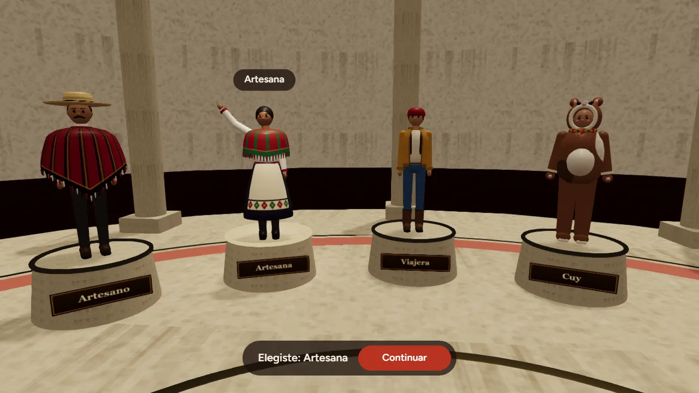
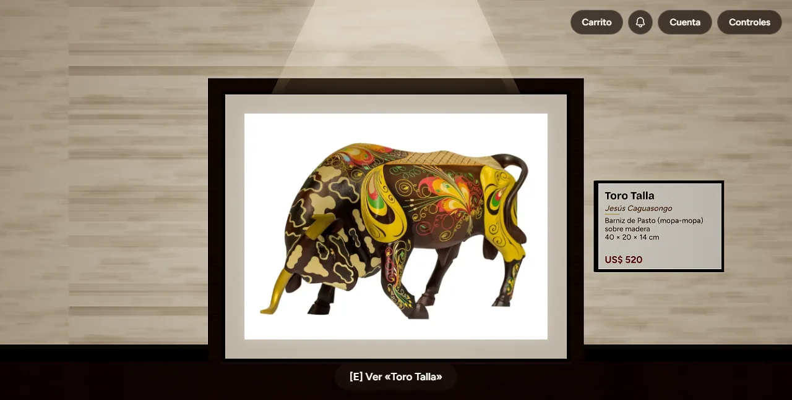
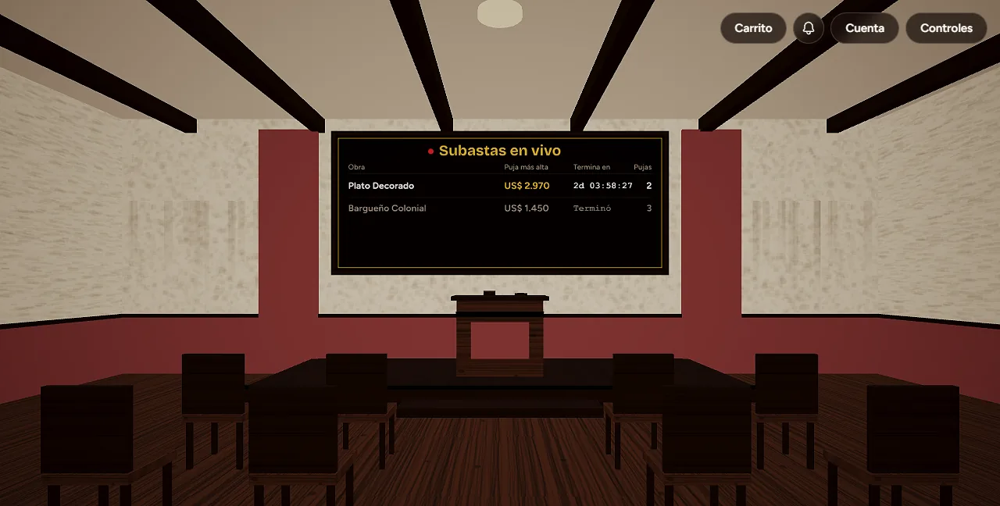
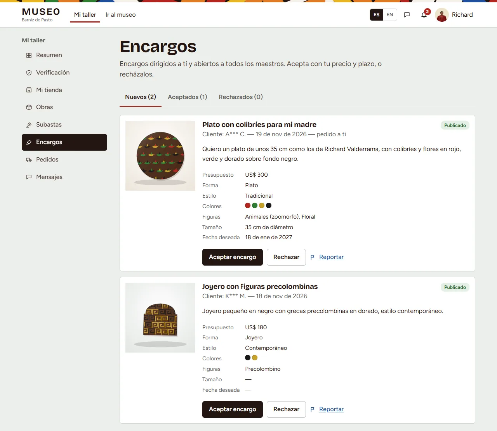
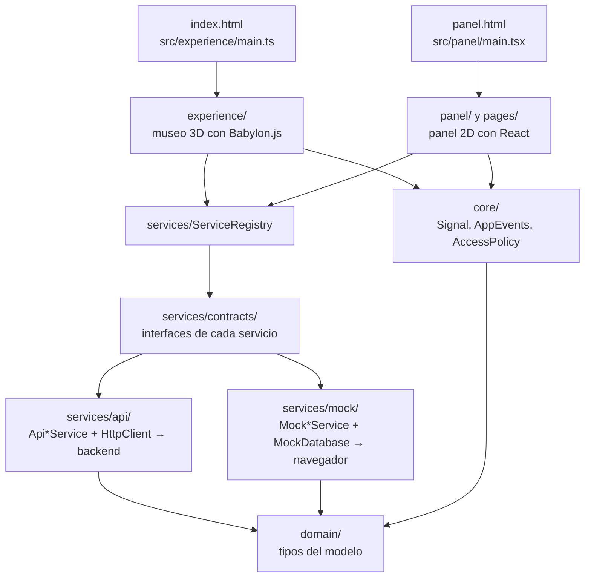

# MUSEO — Barniz de Pasto Mopa-Mopa

MUSEO es una galería virtual en 3D del **Barniz de Pasto Mopa-Mopa**, la técnica artesanal de Nariño declarada Patrimonio Cultural Inmaterial de la Humanidad.
El visitante recorre una plaza con las salas de seis maestros reales, ve sus obras colgadas como cuadros, puja en subastas y pide piezas por encargo con diseños de IA.
Proyecto del curso **Patrones de Software** de la **Universidad Cooperativa de Colombia**.

**App desplegada:** https://barniz-gallery-frontend.vercel.app (museo 3D) · https://barniz-gallery-frontend.vercel.app/panel.html (panel de artesanos y administración)

## Capturas

**Vestíbulo:** el visitante elige el avatar que lo acompaña por el museo.



**Sala de un maestro:** cada obra es su foto enmarcada, con su foco y una placa con título, maestro, técnica, medidas y precio.



**Sala de subastas:** podio, sillas y un tablero con las subastas activas y su cuenta regresiva en vivo.



**Panel del artesano:** los encargos dirigidos al maestro, con filtros, para aceptarlos o rechazarlos.



## Qué hace

**Museo 3D (`index.html`)**
- **Vestíbulo:** idioma (español o inglés), avatar (cinco avatares hechos en código) y taquilla para iniciar sesión, registrarse o entrar como visitante.
- **Plaza:** fuente, quiosco de gustos (recomienda las dos salas más afines al visitante), caja y seis salas, una por maestro.
- **Salas de los maestros:** cada obra es su foto principal enmarcada en la pared, con la proporción real, un foco y una placa. Con clic o **E** se abre la ficha de la pieza, con fotos, precio, carrito y "Guardar".
- **WhatsApp:** si el maestro tiene número, la ficha de la pieza y un atril en su sala abren `wa.me` con un mensaje listo.
- **Sala de subastas:** las obras en subasta, un tablero en vivo y una ficha para pujar, con historial (nombres enmascarados), incremento mínimo y cuenta regresiva. En una subasta terminada se ve quién ganó, y el ganador puede pagar su pedido.
- **Sala de encargos:** el cliente describe la pieza, genera diseños de IA, publica el encargo y recibe ofertas de los maestros; al aceptar una, paga el anticipo.
- **Carrito y pagos:** dirección de envío y pasarela de pago (Tarjeta, PSE o Nequi).
- **Notificaciones:** campana con el contador de no leídas, lista y avisos emergentes (pago aprobado, oferta nueva, te superaron en una puja, ganaste una subasta).
- Solo para computador: en celulares y tabletas muestra un aviso.

**Panel 2D (`panel.html`)**
- **Artesano:** verificación del taller, editor de su tienda, obras, subastas, encargos (aceptar con precio, plazo y mensaje, o rechazar con motivo), pedidos por enviar y liquidaciones.
- **Administración:** verificaciones, usuarios, tiendas, catálogos, configuración, pujas sospechosas, reportes, ventas, liquidaciones y auditoría.

**Backend real y datos simulados**

Cada servicio puede usar el backend real o una versión simulada que guarda los datos en el navegador. Se elige servicio por servicio con `VITE_REAL_SERVICES` (ver [Cómo ejecutarlo](#cómo-ejecutarlo)). En la app desplegada:

| Servicio | Estado |
|---|---|
| `auth` (inicio de sesión y registro), `catalog`, `gallery` (obras y tiendas), `auction` (subastas), `notification` | **Backend real** |
| `customOrder` (**encargos**), `commerce` (carrito, pedidos y pagos), `profile`, `messaging`, `artisan` (panel del artesano), `admin` | Simulados |

En producción no hay cuentas de demostración: cada persona crea su cuenta con **"Registrarse"**.

## Tecnologías

| Tecnología | Versión (`package.json`) | Uso |
|---|---|---|
| TypeScript | ~5.8.3 | Todo el código, en modo estricto (`strict`, `noUnusedLocals`, `noUnusedParameters`) |
| Vite | ^6.3.5 | Servidor de desarrollo y build, con dos entradas |
| Babylon.js (`@babylonjs/core`, `gui`, `loaders`) | ^8.56.2 | El museo 3D, sin React |
| React y React DOM | ^19.1.0 | Solo el panel 2D |
| React Router | ^7.6.0 | Rutas del panel (`HashRouter`) |
| Fuentes `@fontsource` | ^5.3.0 | Figtree, Bricolage Grotesque y Fraunces, empaquetadas localmente |
| sharp (desarrollo) | ^0.35.5 | Optimiza las fotos de las obras a WebP |

## Arquitectura

Dos puntos de entrada comparten el mismo dominio, los mismos servicios y los mismos textos:



- **`domain/`:** los tipos del modelo (usuario, galería, comercio, subasta, encargo, mensajes), sin lógica.
- **`services/contracts/`:** una interfaz por servicio. `services/api/` la implementa contra el backend y `services/mock/` con datos en el navegador.
- **`ServiceRegistry`:** elige, servicio por servicio, la implementación real o la simulada. Ni el museo ni el panel saben cuál están usando.
- **`core/`:** utilidades compartidas, como las señales (`Signal`), los eventos de la app y la matriz de accesos (`AccessPolicy`).
- **`experience/`:** el museo 3D (vestíbulo, plaza, mundo y tableros).
- **`pages/`:** las páginas del panel.

## Patrones de diseño

| Patrón | Dónde está | Para qué sirve |
|---|---|---|
| Facade | `World` (`src/experience/world/World.ts`) | Única puerta al mundo 3D: la interfaz no conoce escenas, mallas ni cámaras. |
| Template Method | `SceneComponent`, `PlazaHall`, `Stall`, `ProceduralAvatar`, `BoardView` y `BoardFormView` | La clase base fija los pasos (construir, actualizar, armar un tablero) y cada subclase completa los suyos. |
| Builder | `AvatarPartBuilder`, `HallRoomShell`, `BoardSheet` | Arman paso a paso un avatar, el cuarto de una sala o la hoja de un tablero. |
| Abstract Factory + Bridge | `UiKit` con `DomUiKit` y `BabylonUiKit`; `PanelSurface` con `DomPanelSurface` y `BabylonPanelSurface` | Las mismas vistas se dibujan en HTML o dentro del mundo 3D (`?ui=babylon`) sin cambiar su código. |
| Adapter | `Api*Service` y `Mock*Service`; `WorldRoomsLoader`, `CommissionHallLoader`, `AuctionBoardFeed` | Adaptan el backend y los datos simulados a una misma interfaz, y los datos de los servicios a lo que necesita el mundo 3D. |
| Strategy | Contratos de `src/services/contracts/` con sus implementaciones `Api*` y `Mock*` | Dos implementaciones intercambiables de cada servicio, elegidas según la configuración. |
| Singleton + Factory | `ServiceRegistry`, `HttpClient`, `MockDatabase` | Una sola instancia de cada servicio, del cliente HTTP y de la base simulada. |
| Factory | `MaterialLibrary`, `AvatarFactory` | Crean los materiales del mundo y los avatares (de un `.glb` o hechos en código). |
| Observer | `Signal`, `AppEvents`, `NotificationCenter`, `AuctionBoardFeed` | Avisan de cambios (carrito, notificaciones, subastas en vivo) sin acoplar a quien emite con quien escucha. |
| Mediator | `ExperienceUi`, `PurchaseFlow`, `CommissionFlow`, `AuctionFlow`, `AccountFlow`, `TasteFlow` | Deciden qué tablero sigue en cada proceso; los tableros no se conocen entre sí. |
| State | `Stage`, con `LobbyStage`, `PlazaStage` y `AvatarStudio` | El museo está en una etapa a la vez (vestíbulo o plaza) y la cambia completa. |
| Flyweight | `GalleryLights` | Todos los cuadros comparten los mismos materiales del haz y el halo de los focos. |

## Roles y accesos

La matriz está en un solo lugar, `src/core/AccessPolicy.ts`, y la usan el museo 3D, el panel y los servicios simulados. Estos responden `403 forbidden`, igual que el backend.

| Acción | Visitante | Cliente | Artesano | Administrador |
|---|:---:|:---:|:---:|:---:|
| Recorrer el 3D, ver obras y subastas, quiosco de gustos | ✅ | ✅ | ✅ | ✅ |
| Carrito y compra, pujas, encargos, favoritos | Pide iniciar sesión | ✅ | ❌ | ❌ |
| Notificaciones y cuenta | ❌ | ✅ | ✅ | ✅ |
| Panel (`panel.html`) | ❌ | ❌ | ✅ | ✅ |
| Tienda, obras, pedidos, encargos y subastas propios | ❌ | ❌ | ✅ solo si está aprobado (antes, solo la verificación) | ❌ |
| Administración | ❌ | ❌ | ❌ | ✅ |

Si un rol entra a una ruta del panel que no le corresponde, vuelve a su inicio con un aviso. El detalle por endpoint, con los errores que debe responder el backend, está en [docs/accesos-backend.md](docs/accesos-backend.md).

## Rendimiento

- **Fusión por material (`MeshBatcher`):** las partes fijas de cada sala y de la plaza se unen en una malla por material. Al introducirla, la entrada de la plaza bajó de 1760 a 977 draw calls y de 712 a 369 mallas, en calidad alta (commit `530557e`).
- **Segunda cámara para las fotos (`PhotoPass`):** dentro de una sala, las fotos se dibujan otra vez después del post-proceso, sin bloom, SSAO ni ajuste de tono, para conservar sus colores reales.
- **Texturas por distancia (`PhotoTexture`):** cada foto se carga a 1024 px dentro de la sala, a 2048 px a menos de 4,5 m y se libera a más de 40 m. Lleva mipmaps y filtrado anisotrópico.
- **Detalle por distancia:** la foto y la placa de un cuadro no se dibujan a más de 24 m.
- **Avatares de una sola malla:** cada avatar es una sola malla con esqueleto.
- **Gestor de calidad (`QualityManager`):** perfiles `low`, `medium` y `high`, con sombras, antialiasing, bloom, SSAO y resolución. Baja solo de perfil si el juego pasa unos 4 segundos por debajo de 28 FPS. Se fija con `?quality=low|medium|high`.
- **Depuración:**
  - `?debug` muestra un contador de FPS, draw calls y mallas, y expone la escena en la consola.
  - `?debug=avatars` abre el estudio de avatares.
  - `?ui=babylon` dibuja los tableros dentro del mundo 3D en vez de en HTML.
- **Carga separada:** Babylon.js solo lo descarga `index.html`; el panel no lo carga.

## Cómo ejecutarlo

**Requisitos:** Node.js 20 o superior (probado con Node 24). Los scripts del inventario de obras (`npm run import:obras` y `npm run seed:obras`) necesitan Node 22.18 o superior.

```bash
npm install
cp .env.example .env.local   # en Windows: copy .env.example .env.local
npm run dev                  # museo en http://localhost:5173 y panel en http://localhost:5173/panel.html
npm run build                # revisa los tipos (tsc) y genera dist/
npm run preview              # sirve dist/ en http://localhost:4173
```

**Variables de entorno** (`.env.example`):

| Variable | Qué hace | Ejemplo |
|---|---|---|
| `VITE_API_URL` | URL del backend | `http://localhost:8080` |
| `VITE_USE_MOCKS` | `true`: los servicios usan datos simulados en el navegador, salvo los de `VITE_REAL_SERVICES`. `false`: todos usan el backend. | `true` |
| `VITE_REAL_SERVICES` | Servicios que usan el backend real aunque `VITE_USE_MOCKS` sea `true`, separados por comas. Valores: `auth, catalog, profile, gallery, commerce, auction, customOrder, messaging, notification, artisan, admin` | `auth,catalog,gallery,auction,notification` |

Con datos simulados no hace falta backend. El enlace **"Restablecer datos de demo"** del pie de página del panel borra lo guardado en el navegador.

**Obras y fotos de los maestros:** el inventario real está en `data/maestros.csv` y `data/obras.csv`. Dos scripts lo pasan a la app:
- `npm run import:obras -- --src <carpeta de originales>` optimiza las fotos a WebP en `public/obras/`.
- `npm run seed:obras` genera `src/services/mock/RealInventory.ts`, los datos de los maestros y las obras.

## Backend e IA

- **Backend:** [BarnizGallery-Backend](https://github.com/Luisaparrac/BarnizGallery-Backend). El frontend lo llama con `Authorization: Bearer <token>` a través de `HttpClient`.
- **IA:** [BarnizGallery-IA](https://github.com/Luisaparrac/BarnizGallery-IA). El frontend no llama a la IA directamente: la consume a través del backend, por ejemplo al generar los diseños de un encargo.

## Estructura de carpetas

```
data/                inventario real de maestros y obras (CSV)
docs/                accesos por rol para el backend e imágenes del README
public/              fotos optimizadas de las obras y retratos de los avatares
scripts/             scripts del inventario: importar fotos y generar los datos
src/
  art/               imágenes generadas en código para datos de ejemplo y diseños simulados
  components/        componentes React del panel
  config/            configuración leída del .env
  core/              Signal, AppEvents, AccessPolicy y otras utilidades compartidas
  domain/            tipos del modelo
  experience/        museo 3D: vestíbulo, plaza, mundo, tableros y HUD
  i18n/              textos en español e inglés
  pages/             páginas del panel: artesano, administración y compartidas
  panel/             punto de entrada y rutas del panel
  services/          contratos, implementación real (api) y simulada (mock), ServiceRegistry
  state/             contextos de React: sesión, idioma, catálogos y avisos
  styles/            CSS del panel
  utils/             formato de fechas y dinero, enmascarado de nombres
index.html           entrada del museo 3D
panel.html           entrada del panel 2D
```

## Limitaciones y trabajo pendiente

- **Sin pruebas automáticas:** el proyecto no tiene pruebas unitarias ni de integración. La verificación se hace con el chequeo de tipos de `npm run build` y revisando a mano con capturas.
- **Encargos simulados:** el módulo de encargos, incluidos los diseños de IA, sigue con datos simulados. También están simulados el carrito y los pagos, el perfil, los mensajes, el panel del artesano y la administración.
- **Subastas reales pendientes de la moneda:** las subastas ya usan el backend, pero falta resolver la moneda.
- **Precios provisionales:** los precios de las obras del inventario aún no son los definitivos.
- **Solo computador:** no hay controles táctiles para celulares ni tabletas.

## Equipo

- Luisa Fernanda Parra Cabrera
- *(completar)*
- *(completar)*
